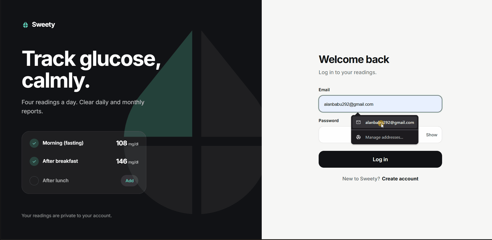

# Sweety – Blood Glucose Tracker

A calm, simple blood glucose tracking application. Log up to four readings a day, manage your records, and view daily and monthly reports.

<p align="center">
  
</p>

<p align="center">
  <a href="https://sweety-fawn.vercel.app/">Live Demo</a> ·
  <a href="#features">Features</a> ·
  <a href="#tech-stack">Tech Stack</a> ·
  <a href="#api-reference">API Reference</a> ·
  <a href="#run-locally">Run Locally</a>
</p>

<p align="center">
  
  
  
  
  
  
  
</p>

<!--
  DEMO: replace the file below with your own 10 to 20 second GIF.
  Record it, save it as docs/demo.gif (keep it under 10 MB) and push it.
-->
<p align="center">
  
</p>

> The live demo runs on free hosting. If it has been idle, the first request can take up to a minute while the server wakes up.

**Live Application:** [https://sweety-fawn.vercel.app/](https://sweety-fawn.vercel.app/)

---

## Why Sweety?

People managing blood glucose levels often need to record readings at different times of the day. Keeping track of these readings manually can become inconvenient.

Sweety provides a simple way to record and review those readings.

Users can record morning fasting, after-breakfast, after-lunch and after-dinner readings. They can also view daily and monthly summaries without maintaining a spreadsheet.

The project focuses on secure authentication, data ownership, validation, reliable date handling and a responsive user interface.

## Features

### User features

- User registration and login.
- Add, edit and delete blood glucose readings.
- Four fixed daily reading slots:
  - Morning (fasting)
  - After breakfast
  - After lunch
  - After dinner
- Reading values between 40 and 600 mg/dL.
- One reading per slot per day.
- Maximum of four readings per day.
- Prevents readings from being recorded for future dates.
- Date navigation and daily reading history.
- Daily, month-to-date and previous-month reports.
- Highest, lowest, average and reading count.
- Monthly glucose trend chart.
- Responsive interface for mobile and desktop.

### Security and reliability

- Password hashing with bcrypt.
- JWT-based authentication.
- Protected API routes.
- Users can access only their own readings.
- Server-side input validation.
- Parameterised SQL queries.
- Database constraints for reading values and duplicate slots.
- Helmet security headers.
- CORS origin restrictions.
- Rate limiting for authentication endpoints.
- Centralised error handling.
- Environment variable validation.
- Graceful server shutdown.

## Tech Stack

| Layer | Technology |
|---|---|
| Frontend | React 19, React Router, Vite |
| Styling | Tailwind CSS 4 |
| HTTP Client | Axios |
| Backend | Node.js, Express |
| Database | PostgreSQL |
| Database Hosting | Neon |
| Authentication | JWT, bcrypt |
| Security | Helmet, CORS, express-rate-limit |
| Backend Testing | Jest, Supertest |
| Frontend Testing | Vitest, React Testing Library |
| Frontend Hosting | Vercel |
| Backend Hosting | Render |
| Containerisation | Docker, Docker Compose |

## Architecture

```text
             Browser
                |
                v
       React + Vite Frontend
          (Vercel)
                |
           HTTPS / JSON
          JWT Authentication
                |
                v
        Node.js + Express API
             (Render)
                |
          Parameterised SQL
                |
                v
          PostgreSQL
             (Neon)
```

The frontend communicates with the backend through REST APIs.

The backend separates routes, middleware and services. Routes handle HTTP requests, middleware handles authentication and request processing, and services contain business logic and database operations.

## Project Structure

```text
sweety/
│
├── client/
│   ├── public/
│   ├── src/
│   │   ├── components/
│   │   │   ├── AppShell.jsx
│   │   │   ├── ReadingForm.jsx
│   │   │   ├── ConfirmDialog.jsx
│   │   │   ├── ErrorPage.jsx
│   │   │   └── GlucoseTrendChart.jsx
│   │   ├── hooks/
│   │   │   └── useAuth.js
│   │   ├── pages/
│   │   │   ├── Login.jsx
│   │   │   ├── Register.jsx
│   │   │   ├── Readings.jsx
│   │   │   └── Reports.jsx
│   │   ├── test/
│   │   ├── AuthContext.js
│   │   ├── AuthProvider.jsx
│   │   ├── api.js
│   │   └── main.jsx
│   ├── Dockerfile
│   └── package.json
│
├── server/
│   ├── src/
│   │   ├── db/
│   │   │   ├── migrations/
│   │   │   ├── pool.js
│   │   │   ├── migrate.js
│   │   │   └── seed.js
│   │   ├── middleware/
│   │   ├── routes/
│   │   ├── services/
│   │   ├── utils/
│   │   ├── app.js
│   │   ├── config.js
│   │   └── index.js
│   ├── tests/
│   ├── Dockerfile
│   └── package.json
│
├── docker-compose.yml
└── README.md
```

## API Reference

Authentication routes:

| Method | Endpoint | Description |
|---|---|---|
| POST | `/auth/register` | Register a new user |
| POST | `/auth/login` | Authenticate a user |
| GET | `/auth/me` | Get the current authenticated user |

Reading routes:

| Method | Endpoint | Description |
|---|---|---|
| GET | `/readings` | Get readings |
| POST | `/readings` | Create a reading |
| PUT | `/readings/:id` | Update a reading |
| DELETE | `/readings/:id` | Delete a reading |

Report routes:

| Method | Endpoint | Description |
|---|---|---|
| GET | `/reports/daily?date=YYYY-MM-DD` | Daily report |
| GET | `/reports/month-to-date?date=YYYY-MM-DD` | Month-to-date report |
| GET | `/reports/monthly?date=YYYY-MM-DD` | Previous-month report |

Health routes:

| Method | Endpoint | Description |
|---|---|---|
| GET | `/health` | Application health check |
| GET | `/health/ready` | Database readiness check |

All routes except registration, login and health checks require a valid JWT bearer token.

## Security and Engineering Decisions

- **Password security:** Passwords are hashed using bcrypt instead of being stored as plain text.
- **Authentication:** JWT tokens are verified before protected requests are processed.
- **Data ownership:** Reading queries are scoped to the authenticated user's ID.
- **Database integrity:** Unique constraints prevent duplicate readings for the same user, date and slot.
- **Input validation:** Reading values, dates and slots are validated on the server.
- **Date handling:** PostgreSQL DATE values are preserved as `YYYY-MM-DD` strings to avoid unwanted timezone conversions.
- **Timezone awareness:** The application uses the user's timezone when determining the current date.
- **Error handling:** Server errors are handled centrally without exposing sensitive database details to clients.
- **Rate limiting:** Authentication endpoints have rate limits to reduce abuse.
- **Configuration:** Production environment variables are validated during application startup.

## Run Locally

### Prerequisites

- Node.js 20 or newer.
- npm.
- Docker Desktop, or a PostgreSQL installation.
- Git.

### 1. Clone the repository

```bash
git clone https://github.com/alanbabu518-spec/sweety.git
cd sweety
```

### 2. Start PostgreSQL

Start only the database service when running the frontend and backend manually:

```bash
docker compose up -d db
```

The local PostgreSQL database is exposed on port `5435`.

### 3. Configure and run the backend

```bash
cd server
npm install
```

Create your environment file:

```powershell
copy .env.example .env
```

Configure the values in `server/.env`.

Run database migrations:

```bash
npm run migrate
```

Start the development server:

```bash
npm run dev
```

The API runs at:

`http://localhost:4000`

### 4. Configure and run the frontend

Open another terminal:

```bash
cd client
npm install
```

Create the environment file:

```powershell
copy .env.example .env
```

Set the API URL:

```env
VITE_API_URL=http://localhost:4000
```

Start the frontend:

```bash
npm run dev
```

Vite will display the frontend URL, usually:

`http://localhost:5173`

Make sure the backend's `CLIENT_ORIGIN` matches the frontend URL.

## Environment Variables

Never commit real secrets or `.env` files.

### Server

See `server/.env.example` for the complete configuration.

| Variable | Description |
|---|---|
| `DATABASE_URL` | PostgreSQL connection string |
| `JWT_SECRET` | Secret used to sign JWT tokens |
| `JWT_EXPIRES_IN` | JWT token expiration |
| `CLIENT_ORIGIN` | Allowed frontend origin |
| `NODE_ENV` | Application environment |
| `PORT` | Backend server port |
| `APP_TIMEZONE` | Default application timezone |
| `TRUST_PROXY` | Trusted proxy configuration |
| `RATE_LIMIT_WINDOW_MINUTES` | Rate-limit time window |
| `LOGIN_RATE_LIMIT_MAX` | Maximum failed login attempts |
| `REGISTER_RATE_LIMIT_MAX` | Maximum registration attempts |

### Client

See `client/.env.example`.

| Variable | Description |
|---|---|
| `VITE_API_URL` | Backend API base URL |

Vite environment variables are included during the build. Redeploy the frontend after changing production environment variables.

## Demo Seed Data

A seed script is included to create a demo user and sample glucose readings.

From the server directory, configure `DATABASE_URL` to point to your intended database, then run:

```bash
npm run seed
```

The seed script creates or updates the demo account and refreshes its sample readings. It does not delete other users' records.

The demo credentials are printed by the seed script. Only use the demo credentials on a database where you intend to create the public demo account.

**Important:** Running the seed script against a production database changes that database. Verify the connection string before executing it.

## Testing

### Backend tests

From the server directory:

```bash
npm test
```

The backend tests use Jest and Supertest to cover authentication, authorization, validation, reports, database behaviour and error handling.

The tests require a PostgreSQL test database. Follow the Docker Compose database setup and the test configuration in the server project.

### Frontend tests

From the client directory:

```bash
npm test
```

Frontend tests use Vitest and React Testing Library.

### Frontend lint and build

```bash
npm run lint
npm run build
```

## Docker

To run the complete containerised application from the project root:

```bash
docker compose up --build
```

The configured local application URLs are:

- Frontend: `http://localhost:8081`
- Backend: `http://localhost:4000`
- PostgreSQL: `localhost:5435`

To stop the containers:

```bash
docker compose down
```

The named PostgreSQL volume preserves database data. Avoid `docker compose down -v` unless you intentionally want to delete the database volume.

## Deployment

The application is deployed using:

| Component | Platform |
|---|---|
| Frontend | Vercel |
| Backend | Render |
| PostgreSQL | Neon |

Production environment configuration:

- Set `VITE_API_URL` to the deployed backend URL on Vercel.
- Set `DATABASE_URL` to the Neon connection string on Render.
- Set a strong `JWT_SECRET` on Render.
- Set `NODE_ENV=production`.
- Set `CLIENT_ORIGIN` to the exact deployed frontend origin.
- Run database migrations as part of the backend deployment process.

Live application:

https://sweety-fawn.vercel.app/

## Notes

### Assumptions

- Each user can record a maximum of four readings per day.
- The four reading slots are fixed: morning fasting, after breakfast, after lunch and after dinner.
- Reading values must be whole numbers between 40 and 600 mg/dL.
- A user can have only one reading for each slot on a particular date.
- Future dates are not allowed.
- Reports use the readings belonging to the authenticated user only.
- The application is intended for personal tracking and does not provide medical advice.

### What I would improve with more time

- Add configurable personal glucose target ranges.
- Add PDF and CSV report exports.
- Add profile management and password-change functionality.
- Improve automated end-to-end testing.
- Add optional reminders for daily reading slots.
- Improve monitoring, logging and production observability.

## Disclaimer

Sweety is a personal blood glucose logging tool. It does not diagnose conditions or provide medical advice. Always follow the advice of a qualified healthcare professional.

## Author

**Alan Babu**

- GitHub: https://github.com/alanbabu518-spec
- LinkedIn: https://www.linkedin.com/in/alan-babu-921ba92a6/
- Email: alanbabu518@gmail.com
